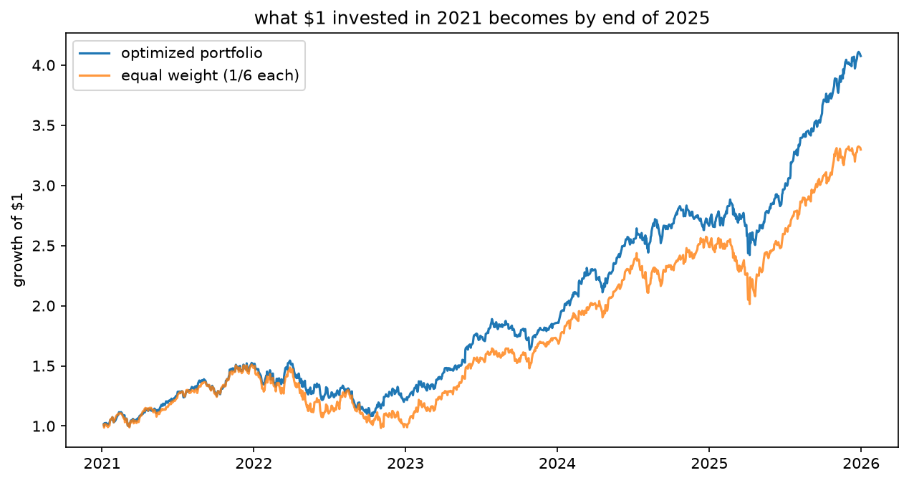
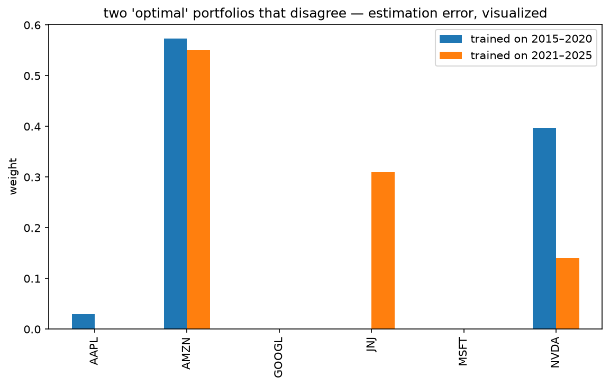
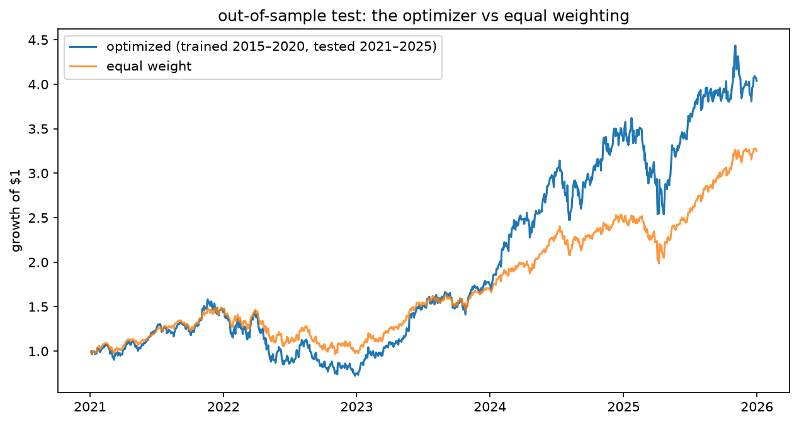

# Portfolio Optimizer — Modern Portfolio Theory in Python

An implementation of Harry Markowitz's **Modern Portfolio Theory (MPT)** using 5 years of historical US equity data (`2021–2025`), Monte Carlo simulation (`10,000` random allocations), and exact constrained optimization (`scipy.optimize` SLSQP).

## What It Does
* Downloads 5 years of daily closing prices for 6 US stocks (`AAPL`, `MSFT`, `NVDA`, `AMZN`, `GOOGL`, `JNJ`) via `yfinance`
* Computes annualized returns ($\times 252$), annualized volatility ($\times \sqrt{252}$), and the asset correlation matrix
* Simulates 10,000 random portfolios (Monte Carlo) to map out the **Efficient Frontier**
* Solves for the exact **Maximum Sharpe Ratio** portfolio using `scipy.optimize.minimize` (SLSQP)
* Compares cumulative wealth growth of `$1` invested in the optimized portfolio vs. an equal-weight (`1/6`) benchmark

## Results (6 US Stocks, 2021–2025)

| Portfolio | $1 Grows To | Max Sharpe |
| :--- | :--- | :--- |
| **Optimized (`AMZN` 55%, `JNJ` 31%, `NVDA` 14%)** | **$4.07** | **1.49** |
| **Equal Weight (1/6 each)** | **$3.30** | **—** |

* **Diversification in action:** Even though `JNJ` had the lowest annual return (`9.9%`), the optimizer allocated **31%** to it because its near-zero correlation with tech stocks (`0.01` with `AMZN`, `-0.10` with `NVDA`) dampens overall portfolio variance ($\mathbf{w}^T \boldsymbol{\Sigma} \mathbf{w}$).
* **Honest caveat:** Optimization on historical means and covariances is **in-sample** and amplifies estimation error. Future iterations can incorporate out-of-sample walk-forward testing, weight caps, or shrinkage estimators.

## Efficient Frontier Chart



## Part 2 — Out-of-sample test: does the optimizer predict the future?

Part 1 was graded on the same 2021–2025 data the weights were learned from.
Part 2 splits honestly: **train on 2015–2020, freeze the weights, test on 2021–2025.**

| Metric | Optimized (OOS) | Equal weight |
|---|---|---|
| $1 becomes | $4.04 | $3.25 |
| annual return | 34.7% | 26.5% |
| annual volatility | 36.6% | 23.8% |
| Sharpe ratio | 0.95 | **1.12** |
| max drawdown | −54% | **−35%** |

The optimized portfolio won on raw dollars — but only because its frozen
2015–2020 recipe was 40% NVDA, right before the largest single-stock run in
market history. It carried far more risk and a −54% crash in 2022; on
risk-adjusted terms, simple equal-weighting won.

The two training windows even disagree with each other (below). **Optimal
weights are unstable because input estimates are unstable** — the core
practical problem of Markowitz optimization, demonstrated rather than asserted.




This is not a prediction model; it computes optimal weights for the past.
Future work: rolling walk-forward re-optimization, weight caps, shrinkage
estimators.

## How to Run
```bash
pip install -r requirements.txt
jupyter notebook 01_download_data.ipynb
